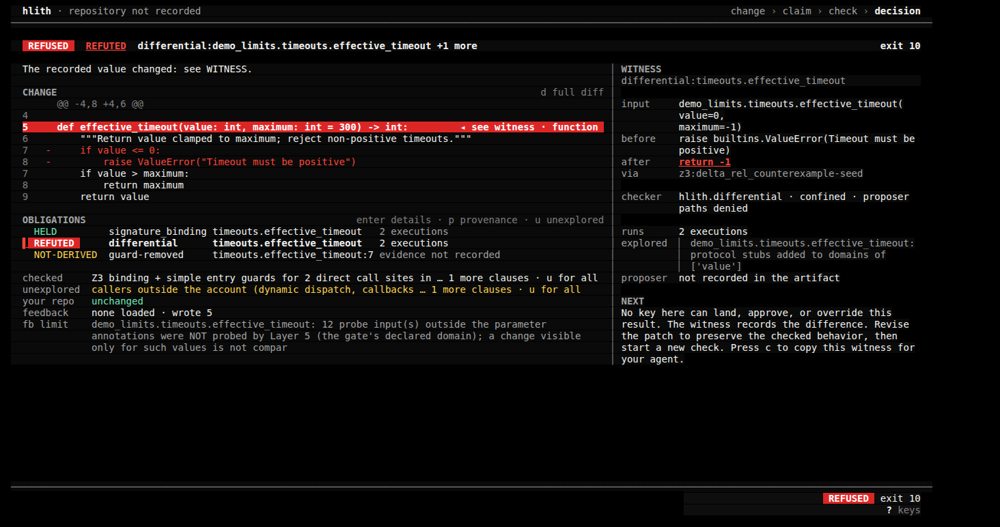

# hlith

`hlith` catches behavior and contract changes your tests miss. It inspects behavioral differences offline in confined disposable clones on supported Linux hosts.



*Authored `examples/first-use` fixture, captured on an earlier authored build. Host-identifying text is redacted; the terminal palette is approximate.*

## What it does

- Compares base and proposed trees inside a confined disposable clone.
- Replays concrete counterexamples when behavior differs.
- Exports a static `pytest` regression guard when the recorded witness shape permits.
- Refuses unproven claims with `UNVERIFIED` or `NOT-DERIVED`.
- Review-only: the supported workflow does not apply changes to the selected repository; `apply`, `run`, `resume` and `propose-deltas` are not part of this distribution.

## First-use specimen

The shipped fixture in [`examples/first-use/patches/01-remove-guard.patch`](examples/first-use/patches/01-remove-guard.patch) removes a non-positive timeout check:

```diff
--- a/demo_limits/timeouts.py
+++ b/demo_limits/timeouts.py
@@ -4,8 +4,6 @@

def effective_timeout(value: int, maximum: int = 300) -> int:
     """Return value clamped to maximum; reject non-positive timeouts."""
-    if value <= 0:
-        raise ValueError("Timeout must be positive")
     if value > maximum:
         return maximum
     return value
```

Existing tests exercise only positive inputs and continue to pass. Running `hlith check --uncommitted` on this authored fixture exits with code `10` (`REFUTED`) and observes:

```text
differential:demo_limits.timeouts.effective_timeout
pre  → raise builtins.ValueError(Timeout must be positive)
post → return -1
input: value=0, maximum=-1
```

This is an authored mechanism fixture, not a real-repository measurement. The complete verification loop (`doctor` → patch → `check` → `replay` → `--pytest-out --expect pre` → non-revert fix → re-check → `LANDED` in the disposable clone) is documented in [`examples/first-use/README.md`](examples/first-use/README.md).

## Usage

Install from the locked source view, then check that the host and Git build support the required features:

```bash
uv sync --frozen --python 3.13.9
source .venv/bin/activate
hlith --version
hlith doctor --repo . --probe-target
```

`doctor` actively probes the required hardened Git read features under the scrubbed environment, including `--attr-source` and `rev-parse --path-format=absolute`; it does not guess from a version number. A missing feature or unavailable confinement is a typed `BOUNDARY` (exit `4`), not a false “no changes” result. Linux 6.12+, unprivileged user namespaces and Landlock ABI 6 or newer are required.

Review a change and inspect the recorded result:

```bash
hlith check --repo . --uncommitted
hlith
```

`hlith` opens the terminal screen for recorded runs and evidence; checks start from the CLI. From the checkout you can also use `uv run --frozen` with an explicit repository. To retain a counterexample:

```bash
hlith replay <RUN_ID> --repo . --pytest-out tests/test_hlith_guard.py --expect pre
```

Export is written only when the replay reproduced. A refused export does not change replay's exit status; read `pytest_export.status`. `--expect` is required (`--pytest-out` alone is a usage error); unsupported witness shapes and witnesses from older builds (`legacy-witness:`) are refused rather than guessed.

## Verdicts

| Exit | Meaning |
| :--- | :--- |
| `10` | REFUTED — a concrete input with both observed outcomes. |
| `12` | UNVERIFIED — hlith could not decide. |
| `11` | NOT-DERIVED — an unmodeled construct or unsupported shape. |
| `4` | BOUNDARY — required host confinement or Git feature is unavailable, or the repository shape/config is unsupported. |
| `0` | LANDED in the disposable rehearsal clone only. |
| `3` | INTERNAL ERROR — the engine failed; nothing was decided. |
| `2` | Usage error. |

`HELD` is an obligation status, not merge permission. It requires a named source-level certificate covering the claimed scope. Passing without an explicit certificate is not `HELD`.

## Where it stops

- Supported hosts require Linux 6.12+, unprivileged user namespaces, Landlock ABI 6 or newer, the feature-probed Git capabilities, and CPython 3.13.9 as measured. Locked installs use `uv`.
- Hlith is not a universal Python verifier, not cross-platform, and not a sandbox guarantee against other processes running as the same user.
- Code under review can lie about itself. Observations are made inside the process that runs the changed code. Hlith does not protect them against code written to falsify them: a REFUTED witness, a test result or an agreement may be forged by such code. The supervisor's own result channel and scratch files are out of that code's reach.
- The supported review workflow uses a disposable clone; no Apply action is present and the human retains the merge decision.
- The one recorded external observation was an intentional behavior/contract change that invalidated the function’s own docstring while all reaching tests passed. It is evidence of the mechanism, not evidence about accidental regressions.
- No HELD verdict on a meaningful real-repository change has been demonstrated.

[Recorded external observation and timings](docs/EXTERNAL-OBSERVATION.md)

## Links

- [Full first-use workflow](examples/first-use/README.md)
- [Installation and usage guide](docs/REVIEW-QUICKSTART.md)
- [Agent integration](docs/AGENT-INTEGRATION.md)
- [CLI reference](docs/CLI.md)
- [Limitations](LIMITATIONS.md)
- [Security boundary](SECURITY.md)
- [Certificate and supported domain](docs/SUPPORTED_DOMAIN.md)
- [Provenance](docs/PROVENANCE.md)
